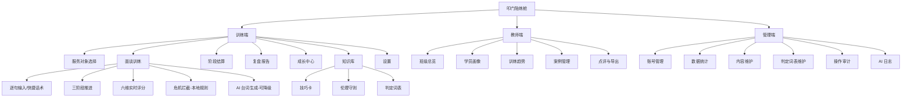
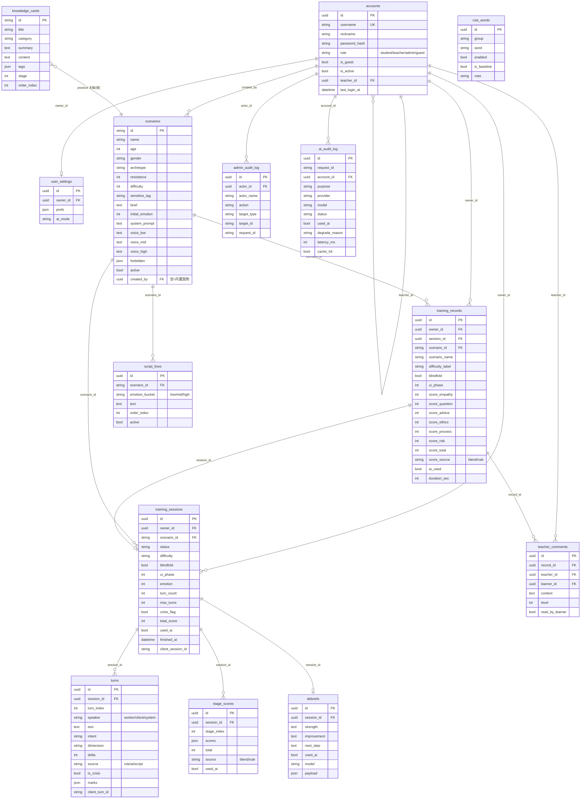
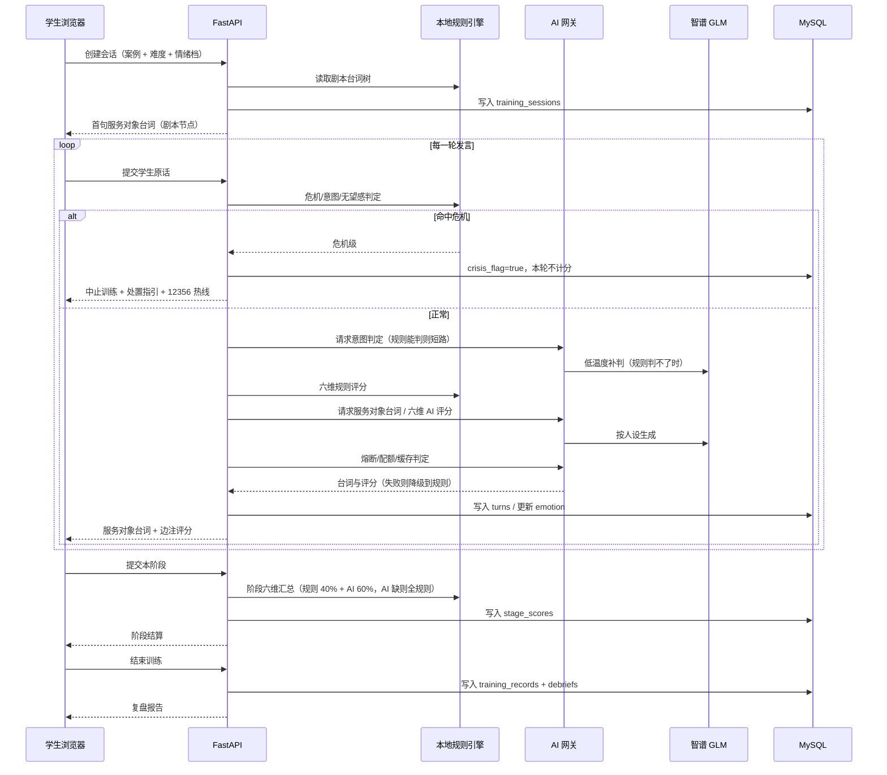
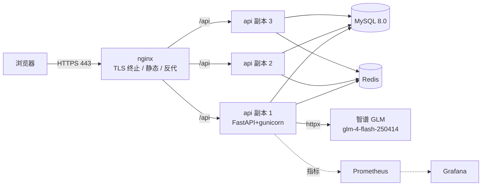

# 功能结构图与实体关系图

> 任务书「四、实现步骤和方法」要求：**系统分析设计——完成需求分析、总体设计
> 与数据库设计，绘制功能结构图与实体关系图**。
> 本文档补齐这两张图，图源已随项目入库，可用任意支持 Mermaid 的工具查看
> （GitHub 直接渲染、VS Code 装 Mermaid 插件、或 mermaid.live 粘贴）。

---

## 一 功能结构图

```
叩门 · 社工个案面谈 AI 陪练舱
│
├── 训练端（学生 / 访客）
│   ├── 01 首页            续练入口、今日推荐案例、角色化导航
│   ├── 02 服务对象选择     12 类内置角色 + 教师自建角色；三档难度
│   ├── 03 面谈训练
│   │   ├── 逐句输入 / 快捷话术
│   │   ├── 三阶段推进（建立关系 → 问题探索 → 评估介入）
│   │   ├── 实时六维评分 + 条款依据（边注栏）
│   │   ├── 危机识别与中止（本地规则，零模型调用）
│   │   └── AI 参与度三档：规则 / 混合 / 全 AI（可降级）
│   ├── 04 阶段结算         本阶段六维小结、是否达基本要求
│   ├── 05 复盘报告         三段式（做得好 / 需改进 / 下一步）+ 逐句点评
│   ├── 06 成长中心         六维雷达、14 天曲线、训练热力图、教师点评
│   ├── 07 知识库           技巧卡 / 伦理守则 / 判定词表，支持案例+关键词+维度筛选
│   ├── 08 关于与声明       合规声明、AI 使用边界
│   └── 09 设置             默认难度、无剧透、AI 开关、数据导出与清理
│
├── 教师端（教师工作台）
│   ├── 班级总览            名下学员、训练量、均分、最弱维度
│   ├── 学员画像            六维雷达 + 14 天趋势
│   ├── 训练趋势            班级均分双轴图、六维均值、案例分布
│   ├── 案例管理            自建服务对象（内置案例只读）
│   └── 点评与导出          逐条点评、成绩 CSV 导出
│
└── 管理端（管理后台）
    ├── 运行概览            在线人数、AI 使用率、错误率
    ├── 账号管理            新建/停用/批量/隐藏访客
    ├── 平台趋势            平台均分趋势、训练热力图
    ├── 内容维护            案例 / 技巧卡 / 台词节点
    ├── 判定词表            9 组词条（危机、无望感受两组为受保护组）
    ├── 操作审计            14 类动作留痕
    └── AI 日志             调用成功率、降级原因、延迟
```

---

## 二 功能结构图（Mermaid）



---

## 三 实体关系图

关系说明（对应真实外键与业务归属）：

- `accounts` 1 — N `training_sessions`（owner_id）
- `accounts` 1 — N `training_records`（owner_id）
- `accounts` 1 — N `accounts`（teacher_id，教师名下学员）
- `scenarios` 1 — N `training_sessions` / `training_records` / `script_lines`
- `training_sessions` 1 — N `turns`、`stage_scores`、`debriefs`
- `training_records` 1 — N `teacher_comments`（record_id）
- `accounts` 1 — N `teacher_comments`（teacher_id / learner_id 各一）
- `accounts` 1 — N `scenarios`（created_by，为空表示内置案例）
- `accounts` 1 — 1 `user_settings`（owner_id）
- `accounts` 1 — N `admin_audit_log`（actor_id）、`ai_audit_log`（account_id）



> `training_records.scenario_name` 与 `difficulty_label` 是**冗余快照**：
> 教师改名或下架案例后，历史记录仍应显示当时的名称，因此不回关联读取。

---

## 四 核心流程（训练一次完整链路）



**关键设计约束**（图中已体现）：

1. **危机判定先于任何模型调用**——命中即中止，不把危机内容送进模型；
2. **规则优先、AI 补位**——规则能判的意图不调用模型（省配额、降延迟）；
3. **AI 失败必须降级**——台词回落台词池、评分回落规则分、复盘回落模板，
   页面不报错；
4. **评分来源留痕**——`score_source` 记录本次是混合还是纯规则，
   因为两种口径不可直接比较。

---

## 五 部署拓扑



> 本机验证时只起 `mysql + redis + api + nginx` 四个核心服务；
> Prometheus / Grafana / Loki 属观测栈，未在本机启动（见部署验证状态）。
